# Production case studies

Seven systems Adrian Capraru built or led into production, written up long form: what was broken, what it cost, the constraints, what was built, the safeguards, the results, and what the client kept. Each one has a system drawing of how it runs.

There is no client code here and no client names beyond role labels ("an Irish tour operator", "a multi-entity B2B software reseller"). Figures are the ones published on [cadi27tech.github.io](https://cadi27tech.github.io/work/); internal measures and estimates are labelled as such where they appear.

| # | System | Headline |
|---|---|---|
| 01 | [Accountancy firm: AI service line from zero, platform live in 10 days](cases/01-accountancy-saas-live-in-10-days.md) | **10 days** first commit to live production |
| 02 | [HighCrowd: EU crowdfunding licence, as COO](cases/02-eu-crowdfunding-licence-asf-authorisation.md) | **Mar 2024** ECSP licence granted by the ASF |
| 03 | [3Descu: factory, platform and MCP server](cases/03-3d-printing-factory-platform-mcp-server.md) | **x65** turnover in three years, 57% net margin |
| 04 | [HubSpot to Xero, multi-entity invoicing](cases/04-hubspot-to-xero-multi-entity-invoicing.md) | **3 entities** 4 currencies, live since April 2026 |
| 05 | [EU-sovereign financial reporting platform](cases/05-eu-sovereign-financial-reporting-platform.md) | **5/5** isolation policies caught by mutation tests |
| 06 | [Tour-operator Xero prepayments, 107/107](cases/06-xero-prepayment-journals-automation.md) | **107/107** match against the bookkeeper's manual entries |
| 07 | [5-hotel daily revenue reporting](cases/07-hotel-group-daily-revenue-reporting.md) | **5 hotels** matched to accounting, cell by cell |

Dashed frame: outside the system. Double frame: a person or a hard check. Bright frame: a result. Orange with a lamp: live in production. Dotted boundary: a zone.

## The drawings

### [01 / Accountancy firm: AI service line from zero, platform live in 10 days](cases/01-accountancy-saas-live-in-10-days.md)

An Irish chartered accountancy and audit firm offered no AI. Adrian built the service line and runs it: a 20-module client platform live in 10 days, EU-only AI processing enforced in code, an AML gate, Irish statute as software, and AI training for the whole firm.

<a href="cases/01-accountancy-saas-live-in-10-days.md"><picture>
  <source media="(max-width: 600px)" srcset="drawings/accountancy-saas-live-in-10-days-m.svg">
  
</picture></a>

### [02 / HighCrowd: EU crowdfunding licence, as COO](cases/02-eu-crowdfunding-licence-asf-authorisation.md)

Three years as COO of a regulated real-estate crowdfunding platform. Adrian was the lead on the authorisation and audit with the ASF, built automated KYC and AML onboarding and the investor-protection flows, and the platform received its EU crowdfunding (ECSP) licence in March 2024.

<a href="cases/02-eu-crowdfunding-licence-asf-authorisation.md"><picture>
  <source media="(max-width: 600px)" srcset="drawings/eu-crowdfunding-licence-asf-authorisation-m.svg">
  
</picture></a>

### [03 / 3Descu: factory, platform and MCP server](cases/03-3d-printing-factory-platform-mcp-server.md)

A 0-to-100 story. An EU start-up grant and 5 printers in 2022; today an ISO 9001:2015 certified company with 200+ printers, buyers in 26 of the 27 EU member states, a 57% net margin with no outside equity, its own quoting platform in four languages, and one of the first manufacturing MCP servers.

<a href="cases/03-3d-printing-factory-platform-mcp-server.md"><picture>
  <source media="(max-width: 600px)" srcset="drawings/3d-printing-factory-platform-mcp-server-m.svg">
  
</picture></a>

### [04 / HubSpot to Xero, multi-entity invoicing](cases/04-hubspot-to-xero-multi-entity-invoicing.md)

Automation that moves real money: closed deals become approved Xero invoices in the right legal entity and currency, emailed to the customer and chased until paid. Live since April 2026, about 52 invoices a month under signed approvals.

<a href="cases/04-hubspot-to-xero-multi-entity-invoicing.md"><picture>
  <source media="(max-width: 600px)" srcset="drawings/hubspot-to-xero-multi-entity-invoicing-m.svg">
  
</picture></a>

### [05 / EU-sovereign financial reporting platform](cases/05-eu-sovereign-financial-reporting-platform.md)

An EU-sovereign financial reporting platform with no US-owned service in the stack: self-hosted in the Netherlands, Microsoft sign-in, Exact Online ledgers turned into board-ready reports for education organisations, and tenant isolation proven by tests.

<a href="cases/05-eu-sovereign-financial-reporting-platform.md"><picture>
  <source media="(max-width: 600px)" srcset="drawings/eu-sovereign-financial-reporting-platform-m.svg">
  
</picture></a>

### [06 / Tour-operator Xero prepayments, 107/107](cases/06-xero-prepayment-journals-automation.md)

Supplier bills read, coded and moved from prepayments to expense by arrival month, as draft journals the bookkeeper approves. Matched the bookkeeper's own entries 107 of 107 before go-live.

<a href="cases/06-xero-prepayment-journals-automation.md"><picture>
  <source media="(max-width: 600px)" srcset="drawings/xero-prepayment-journals-automation-m.svg">
  
</picture></a>

### [07 / 5-hotel daily revenue reporting](cases/07-hotel-group-daily-revenue-reporting.md)

Six daily reports for five hotels, built from the property-management and point-of-sale exports and matched to the accounting team's own figures, cell by cell, for every hotel.

<a href="cases/07-hotel-group-daily-revenue-reporting.md"><picture>
  <source media="(max-width: 600px)" srcset="drawings/hotel-group-daily-revenue-reporting-m.svg">
  
</picture></a>

## How this repo is made

The write-ups and drawing specs come from one content file, the same one that builds [the site](https://cadi27tech.github.io), so the two cannot drift apart. The drawings are rendered with [blueprint-svg](https://github.com/cadi27tech/blueprint-svg): a wide layout and a phone layout per system, served with `<picture>` so they stay readable at 390 px. `node scripts/check.mjs` runs in CI on every push: ASCII punctuation only, every case has both drawings, and every relative link resolves.

## Contact

[cadi27tech.github.io](https://cadi27tech.github.io) &nbsp;/&nbsp; [CV (PDF)](https://cadi27tech.github.io/cv.pdf) &nbsp;/&nbsp; [LinkedIn](https://www.linkedin.com/in/adriancapraru27) &nbsp;/&nbsp; [github.com/cadi27tech](https://github.com/cadi27tech)

The write-ups are copyright Adrian Capraru, all rights reserved; quote them with a link.
