# 01 / An Irish accountancy firm's AI & Automation service line, built from zero, with its client platform live in 10 days

> An Irish chartered accountancy and audit firm offered no AI. Adrian built the service line and runs it: a 20-module client platform live in 10 days, EU-only AI processing enforced in code, an AML gate, Irish statute as software, and AI training for the whole firm.

**10 days** &nbsp; first commit to live production

<picture>
  <source media="(max-width: 600px)" srcset="../drawings/accountancy-saas-live-in-10-days-m.svg">
  
</picture>

Dashed frame: outside the system. Double frame: a person or a hard check. Bright frame: a result. Orange with a lamp: live in production. Dotted boundary: a zone.

| Fact | Detail |
|---|---|
| Client | Irish chartered accountancy and audit firm |
| Role | Director of AI & Business Automation (contractor). Sole owner of AI at the firm, reporting to the principal: scoping, pricing, build, training and support. |
| Timeline | Service line from October 2025. Platform: first build 23 Sep 2026, live 3 Oct 2026, current scope by 21 Oct 2026 |
| Status | Live in production, pre-revenue |

## Context

When Adrian joined, AI was not a service the firm offered. A year later it has its own client platform, a trained team, an AI Academy, published fee packages and automation clients of its own in Ireland, the UK and the US. The flagship is the platform: one place where clients send bills and receipts, see VAT and deadlines, pay suppliers and receive proposals, with the practice working from the same data. Its clients had been paying for separate document-capture tools, and slow quoting was costing the practice prospects.

## What was broken

AI was not a service the firm offered: no client platform, no AI training for staff and no automation offer for its own clients. Client management ran on a 97-field schema that needed an audit before any automation could trust it.

## What it cost

- Clients were paying for separate document-capture tools, and slow quoting was costing the practice prospects.
- A Xero audit joined 749 sales invoices to 587 client records and found 391 records with no invoice in 12 months: a dormant-client and revenue-leak signal for the principal.
- A recurring-tasks automation run on the unaudited data would have created payroll tasks for all 587 clients.

## The brief

Build software a regulated profession can put its name on, fast, without an in-house engineering team. Client financial data, identity numbers and bank details are involved, so data residency, tenant isolation, AML checks and GDPR retention had to exist from the first release, not be retrofitted.

## Constraints

- EU data residency enforced in code, not in policy: Vercel (Dublin), Supabase (eu-west-1), Resend EU, Gemini via Vertex AI in the EU with data caching disabled. A US model is an opt-in fallback only, so client documents never leave the EU silently.
- A regulated profession: AML and customer due-diligence gate, audit log, retention purge, a DPA template.
- No engineering team to maintain it, so the test suite and runbooks had to carry the knowledge.
- Unit economics that beat paid capture tools: target under one cent per document.

## Stakes

A regulated profession puts its name on this software. A client document leaving the EU silently, an account opened before an identity check, or a model guessing a figure on a fee proposal would be a compliance problem for the firm, not a bug.

## Role and team

- Sole owner of AI at the firm, reporting to the principal: scoping, pricing, build, training and support in one seat.
- Partners bring client scenarios; Adrian designs, prices and hands over a proposal-ready brief.
- Validation rounds with the firm's bookkeepers, and decisions with the principal.
- Parallel AI coding agents as the delivery team, each workstream behind review and test gates before deploy.

## What was built

- **20 product modules** (16 client-facing, 4 practice-only): bills and receipts, VAT, supplier payments, credit control, Irish tax deadlines, proposals with a fee calculator, expenses, a client portal. 53 request templates across 14 sectors.
- **AI bills reader.** Two Gemini models via Vertex AI EU reach a consensus on every field, with Claude as an opt-in fallback. VAT numbers are checked against VIES, bills post to Xero, and supplier payments export as SEPA pain.001 files.
- **Irish statute as software.** Revenue deadlines for PAYE, RCT, VAT, Form 46G, LPT and Form 11, CRO audit-exemption tests (S.I. 301/2024), statutory late-payment interest and Irish bank holidays, encoded as rules and covered by tests.
- **An AML gate.** Client account set-up stays blocked until the identity check is verified. IBAN confirmations are admin-only, stamped and audited by a database trigger.
- **AI assistant with confirm-first actions.** A tool-registry agent that runs under the user's own session permissions, proposes an action, and executes only after the user confirms. Per-tenant cost caps. A daily staff brief went live on 7 Oct.
- **Numbers computed, words generated.** The fee engine computes every figure deterministically and lets AI compose only the wording, a rule written down with reference to model non-determinism and Irish DPC guidance.
- **Security by default.** Row-level tenant isolation, CSP and HSTS, masked PPS and IBAN numbers, 192-bit recipient tokens, an audit log and automatic retention purge. SSL Labs grade A.
- **A service the firm can sell.** A five-tier price ladder (Free, Essentials EUR 59, Pro EUR 129, Business EUR 249, Practice Bookkeeping EUR 149) with add-ons, and an AI for Accountants session that trained the full team (10+ people) with live demos, backed by an AI Academy of 8 lessons and 48 prompts.

## How it runs

1. Client uploads a bill or receipt
2. Two EU-hosted models extract every field and must agree
3. VAT number checked against VIES
4. Bill drafted in Xero for review
5. Approved payments exported as a SEPA file

## Timeline

| When | What happened |
|---|---|
| Oct 2025 | Hired as the sole owner of AI. The firm had no AI offer, no client platform and no AI training for staff. |
| Dec 2025 | First deliverable: an AI maturity assessment funnel for lead generation, a 12-node n8n workflow with AI scoring and a four-email nurture. |
| 2026 | Practice management rebuilt for 587 client records and 10 staff plus the owner: 97-field schema audited, 3,172 writes with 0 failures, per-person dashboards, Xero invoicing and credit control at 7, 14, 30 and 60 days. |
| Apr to Oct 2026 | Client delivery under the firm's brand: HubSpot-to-Xero invoicing across 3 legal entities (live April), a SEPA payment-file converter sold as a monthly subscription (live 14 Aug), a co-op's first automated settlement cycle (Aug) and Xero prepayment journals for a tour operator (live 16 Oct). |
| 23 Sep 2026 | First commit of the client platform; multi-tenant the next day. |
| 3 Oct 2026 | Live in production, hosted in the EU. The first deploy smoke test passed 85 of 85. |
| 5 to 7 Oct 2026 | The firm's website split into Accounting and AI & Automation (353 claims fact-checked, 81 of 81 pages clean), the AI Academy live with 8 lessons and 48 prompts, and a daily staff brief from the AI assistant. |
| 13 Oct 2026 | Xero audit of 749 sales invoices against 587 client records; 391 records with no invoice in 12 months flagged to the principal. |
| 15 to 17 Oct 2026 | Bills engine rebuilt: browser path from 86.7% to 97.6%, AI path from 98.6% to 99.8% on the synthetic corpus. 3,230 checks green, 0 failures. |
| 21 Oct 2026 | 20 modules live, five product films on the sales page, fee packages published, and the full team trained in an AI for Accountants session. |

## Safeguards and controls

- EU-only AI processing enforced in code: Vertex AI's EU endpoint with data caching disabled. The US model is an opt-in fallback, never a silent one.
- An AML due-diligence gate: client account set-up stays blocked until the identity check is verified.
- IBAN confirmation is admin-only, stamped and audited by a database trigger; SEPA files are built only from confirmed IBANs.
- A confirm-first AI assistant that runs under the user's own permissions, with per-tenant cost caps. Assistant conversations are deleted 12 months after the last message.
- Tenant isolation in Postgres (row-level security), CSP and HSTS, masked PPS and IBAN numbers, 192-bit recipient tokens, an audit log and a retention purge. Mozilla Observatory 11 of 12, SSL Labs grade A.
- Numbers computed, words generated: the fee engine computes every figure deterministically and AI writes only the wording.

## Results

| Figure | What it measures |
|---|---|
| **10 days** | from first commit (23 Sep) to live production (3 Oct 2026) |
| **20** | modules live within four weeks |
| **99.8%** | field accuracy of the AI bills reader (428 of 429 fields) on a 64-file synthetic test corpus; 97.6% on the browser path, up from 86.7%, with 0 silent errors |
| **< 1 cent** | per document, about USD 0.009 per scan |
| **3,000+** | automated checks green (3,230 with 0 failures on 17 Oct) |
| **87/87** | deploy smoke test on every deploy since 6 Oct (85/85 at launch) |
| **10+** | people trained: the full firm team, in an AI for Accountants session with live demos |

## Before and after

| Area | Before | After |
|---|---|---|
| AI offer at the firm | None | Its own AI & Automation service line, with published fee packages |
| Staff trained in AI | None | The full team (10+), plus an 8-lesson AI Academy |
| Bills reader, browser path (synthetic corpus) | 86.7% | 97.6%, 0 silent errors |
| Bills reader, AI path (synthetic corpus) | 98.6% | 99.8% |
| Payroll tasks on the recurring-tasks dry run | 587, one per client | 38, one per payroll client in Xero |

## Reliability

Fifty backend test files and 55 browser end-to-end suites run before release; the AI assistant has its own unit and end-to-end tests (17/17, 8/8). Every deploy runs an 87-point smoke test against the live system. Accuracy on real client documents has not yet been measured; that is the next evaluation, and the synthetic corpus figure is reported as exactly that.

## Running the practice

Running the practice, alongside the platform: client management was rebuilt for 587 clients and 10 staff, with a 97-field schema cleaned in 3,172 writes and 0 failures. A Xero audit joined 749 sales invoices to the client records and surfaced 391 clients with no billing in 12 months. A recurring-tasks automation was held on dry run because it would have created payroll tasks for all 587 clients; after the data fix, the dry run produced exactly 38, one per payroll client in Xero.

## What the client owns

- The code, the Supabase project and the Vercel account, all in the firm's name.
- A handover document, deploy runbook and the full regression suite.
- Its pricing, packaging and module roadmap, and a team trained to sell and use it.

## Stack

TypeScript, Vercel, Supabase (PostgreSQL, RLS), Gemini via Vertex AI EU, Claude, Xero API, VIES, SEPA pain.001, Resend, n8n

## What was said

> Capraru was extremely knowledgable in N8N, AI and general automation. He put together an excellent workflow that helped us achieve human scoring, automated content. We are hiring him for our next AI automation project.
>
> UK internet-marketing firm, AI workflow automation, n8n, Upwork

---

[Read it on the site](https://cadi27tech.github.io/work/accountancy-saas-live-in-10-days/)
