# 03 / From 5 printers in an apartment to a 200+ printer factory selling into 26 of the 27 EU member states

> A 0-to-100 story. An EU start-up grant and 5 printers in 2022; today an ISO 9001:2015 certified company with 200+ printers, buyers in 26 of the 27 EU member states, a 57% net margin with no outside equity, its own quoting platform in four languages, and one of the first manufacturing MCP servers.

**x65** &nbsp; turnover in three years, 57% net margin

<picture>
  <source media="(max-width: 600px)" srcset="../drawings/3d-printing-factory-platform-mcp-server-m.svg">
  
</picture>

Dashed frame: outside the system. Double frame: a person or a hard check. Bright frame: a result. Orange with a lamp: live in production. Dotted boundary: a zone.

| Fact | Detail |
|---|---|
| Company | 3Descu (TREIDESCUPRINT SRL), on-demand 3D printing for engineering buyers |
| Role | Founder. Strategy, P&L, pricing, production and sales. Hired and trained the team. Sole engineer of the software, with AI coding agents. |
| Timeline | Founded June 2022. Platform built June to October 2026. |
| Status | Operating and growing. Platform and MCP server live. |

## Context

The business plan was written for a Master's in Entrepreneurship and won an EU start-up grant (about EUR 60K, ranked first among applicants). The factory started with 5 printers in a small apartment in Targu Jiu. Within a year it pivoted from consumers to engineering buyers, and it became an approved and audited production partner of one of the largest on-demand manufacturing platforms in the EU.

## What was broken

A factory in a regional town, selling custom parts to engineers across Europe with a team of four. A buyer needed a trustworthy price from a CAD file without waiting for a person, customer records sat in five separate sales channels, and AI assistants had no way to ask the factory for a quote at all: a web form is not an interface a model can use.

## What it cost

- With a team of 4 including contractors, every request answered by hand is time taken from production.
- Five sales channels with different GDPR and marketplace contract rules on who may be contacted.
- No channel at all for the engineers who already ask AI assistants for help.

## The brief

Sell custom manufacturing to engineers across Europe from a regional town, with a team of four. That means instant, trustworthy prices from a CAD file, a checkout that works in the buyer's language and currency, and operations that do not need a sales team to answer every request.

## Constraints

- A team of 4 including contractors, so software has to replace headcount.
- Prices must be right: every quote is a commitment the factory has to honour at a margin.
- Export-led: about half of all orders go to German-speaking markets.
- Customer data from five sales channels, with GDPR and marketplace contract rules on who may be contacted.

## Stakes

A wrong price either loses the order or loses money on it, and across 2,000+ orders the error compounds. The buyers are engineers who come back when the part and the price are right: one in three orders is from a returning customer.

## Role and team

- Founder: strategy, P&L, pricing, production and sales.
- Hired and trained the staff, on site and digitally, with the SOPs and the ISO 9001 audit documentation he wrote. A team of 4 including contractors, plus external production, logistics, certification and creative partners.
- Hands-on across FDM and SLA production, 3D modelling, the full 3D workflow and design for manufacturing.
- Sole engineer of the software, directing parallel AI coding agents behind tests and review gates.

## What was built

- **The team and the operation.** Adrian hired and trained the staff, on site and remotely, and wrote the SOPs and the ISO 9001 audit documentation. He is hands-on with every step: FDM and SLA production, 3D modelling and design for manufacturing.
- **Instant quoting platform** (quote.3descu.com): upload a 3D file, get mesh analysis in the browser (watertight check, volume, bounding box), a price in under a minute, payment by card, bank or PayPal, PDF offers, a customer portal and an admin back office. English, German, French and Dutch.
- **An MCP server** so AI assistants such as ChatGPT and Claude can quote real parts: 4 tools, keyless, rate-limited, prices calibrated on measured parts. Listed in the official MCP Registry as io.github.cadi27tech/3descu-quote, on Glama, and in 4 community directories through merged pull requests.
- **A release gate** of 120+ automated checkers running about 260K assertions on every release, with mutation-tested guards so a checker that stops catching errors is itself caught.
- **A EUR 0 per month social publisher** on GitHub Actions (public repo) that posts a full quarter's calendar on schedule: 45 published, 3 missed, and missed posts are never backfilled.
- **A unified customer ledger**: five sales channels merged into one audited ledger reconciled to within EUR 1, with GDPR and contract suppression rules enforced in code.

## How it runs

1. Engineer uploads a CAD file, or asks an AI assistant
2. Mesh analysed in the browser
3. Price from the calibrated pricing engine
4. Payment and order confirmation
5. Production, shipping and portal tracking

## Timeline

| When | What happened |
|---|---|
| 2022 | A business plan written for a Master's in Entrepreneurship wins an EU start-up grant (ranked first, about EUR 60K, non-repayable). 5 printers in an apartment in Targu Jiu. No outside equity. |
| Jun 2022 | Company registered, production starts on 5 printers in the apartment. |
| 2023 | From consumers to engineering buyers, and approved as a production partner of one of the largest on-demand manufacturing platforms in the EU. |
| 2023 to 2024 | Team hired and trained on site and remotely, SOPs and ISO 9001 audit documentation written, production moved into a dedicated hall (2024). 3Descu is an ISO 9001:2015 certified company. |
| Scale | Fleet past 200 printers and an export business: buyers in 26 of the 27 EU member states, 45% of orders shipping to Germany. |
| 1 Jun 2026 | First commit of the quoting platform. 929 commits and ~400 merged pull requests follow in under five months. |
| 2 Oct 2026 | The platform live in four languages: English, German, French and Dutch. |
| 18 Oct 2026 | MCP server listed in the official MCP Registry; then Glama and 4 community directories through merged pull requests. |
| 21 to 25 Oct 2026 | A zero-budget press launch: 10 articles in national, regional and international trade press within a week. |
| Today | A 200+ printer factory, turnover x65 in three years at a 57% net margin, 2,000+ orders from 1,600+ buyers in 30 countries, rated 4.7/5 by 200+ verified buyers. |

## Safeguards and controls

- ISO 9001:2015 certified company, with documented SOPs.
- GDPR and contract rules enforced in code: marketplace-sourced customer records are held suppression-only.
- e-Factura invoicing with EU VAT reverse charge for VIES-valid business buyers.
- Every release passes 120+ checkers and about 260K assertions; guards are mutation-tested, so a checker that stops catching errors is caught itself.
- Public claims (counts, ratings, press) are checked by scripts for drift against the source data.
- The MCP server is keyless and rate-limited, with prices calibrated on measured parts.

## Results

| Figure | What it measures |
|---|---|
| **5 to 200+** | printers, from an apartment (2022) to a dedicated production hall |
| **x65** | turnover in three years, about EUR 190K in 2025, up 75% year on year, at a 57% net margin (public filings) |
| **2,000+** | orders from 1,600+ buyers in 30 countries, including 26 of the 27 EU member states; 45% of orders ship to Germany; one in three from a returning customer |
| **4.7/5** | rating from 200+ verified B2B buyers |
| **~400** | merged pull requests and 929 commits in under five months, solo, with 38 edge functions |
| **10** | press articles within a week of the AI quoting launch, at zero ad spend |

## Before and after

| Area | Before | After |
|---|---|---|
| Printers | 5, in an apartment (2022) | 200+, in a dedicated production hall |
| Turnover | 2022, the founding year | x65 by 2025, about EUR 190K, at a 57% net margin |
| Customer records | Five separate sales channels | One ledger of 1,863 records, reconciled to within EUR 1 |
| Quotes for AI assistants | No channel | MCP server in the official MCP Registry |

## Reliability

Every release passes 120+ checkers and about 260K assertions. Public claims (counts, ratings, press) are checked by scripts for drift against the source data. 3Descu is an ISO 9001:2015 certified company and ranks 1st in Gorj county in three ListaFirme Topul Firmelor 2026 categories (professional and design services), based on filed accounts.

## What the client owns

- Everything: code in its own repository, its own Supabase and Stripe accounts, no agency in the loop.
- A public MCP server and a public social-publishing agent that others can inspect.

## Stack

React, TypeScript, Supabase (PostgreSQL, Edge Functions), Stripe, Model Context Protocol, GitHub Actions, Meta Graph API

## What was said

> The precision of the parts were astonishingly good
>
> Verified B2B buyer, 3Descu, Custom 3D-printed parts

> The success story of a man from Gorj: Adrian Capraru started with 5 3D printers and built a factory that produces for the whole of Europe.
>
> Gorjul Azi, 21 Oct 2026, [article](https://gorjulazi.ro/2026/10/21/povestea-de-succes-a-unui-gorjean-adrian-capraru-a-pornit-cu-5-imprimante-3d-si-a-construit-o-fabrica-ce-produce-pentru-toata-europa-foto.html)

> Adrian Capraru, the entrepreneur from Gorj turning 3D printing into a European business.
>
> Vocea Olteniei, 24 Oct 2026, [article](https://www.vocea-olteniei.ro/2026/10/24/adrian-capraru-antreprenorul-din-gorj-care-transforma-imprimarea-3d-intr-o-afacere-europeana/)

> 3Descu enables 3D printing quotes through ChatGPT and Claude
>
> 3D Printing Industry, 24 Oct 2026, [article](https://3dprintingindustry.com/news/3descu-enables-3d-printing-quotes-through-chatgpt-and-claude-255887/)

---

[Read it on the site](https://cadi27tech.github.io/work/3d-printing-factory-platform-mcp-server/) &nbsp;/&nbsp; [The quoting platform](https://quote.3descu.com) &nbsp;/&nbsp; [MCP Registry entry](https://registry.modelcontextprotocol.io/v0/servers?search=3descu) &nbsp;/&nbsp; [Social publishing agent (GitHub)](https://github.com/cadi27tech/3descu-social-agent) &nbsp;/&nbsp; [Press coverage](https://cadi27tech.github.io/press/)
