# 04 / HubSpot to Xero invoicing across 3 legal entities and 4 currencies

> Automation that moves real money: closed deals become approved Xero invoices in the right legal entity and currency, emailed to the customer and chased until paid. Live since April 2026, about 52 invoices a month under signed approvals.

**3 entities** &nbsp; 4 currencies, live since April 2026

<picture>
  <source media="(max-width: 600px)" srcset="../drawings/hubspot-to-xero-multi-entity-invoicing-m.svg">
  
</picture>

Dashed frame: outside the system. Double frame: a person or a hard check. Bright frame: a result. Orange with a lamp: live in production. Dotted boundary: a zone.

|  |  |
|---|---|
| Client | Multi-entity B2B software reseller (US, UK and EU companies), delivered through an Irish accountancy firm (case 01) |
| Role | Architect and builder |
| Timeline | Designed February 2026, live 15 April 2026, hardening release 15 September 2026 |
| Status | Live in production |

## Context

A software reseller trades through three legal entities in the US, the UK and the EU, each with its own Xero organisation. Sales run in HubSpot. Customer payments had been collected through the CRM's own payments product, with fees on every invoice.

## What was broken

Sales ran in HubSpot, the books in three Xero organisations. The manual route from the CRM into the ledgers had broken after a change of accountant, and customer payments went through the CRM's own payments product, with fees on every invoice.

## What it cost

- Fees on every invoice paid through the CRM's payments product.
- Deals re-keyed by hand into three ledgers, in four currencies, with different account codes per entity.
- An invoice that is never raised is revenue that is never collected.

## The brief

Turn every Closed Won deal into a correct draft invoice in the right Xero organisation and currency, route it through finance approval, email the customer without landing in spam, and chase payment, without anyone re-keying a deal.

## Constraints

- Three ledgers, four currencies, different account codes per entity.
- Finance must approve every invoice before a customer sees it.
- Deals with several invoices are normal, so duplicates must be impossible, not just unlikely.
- A clear scope rule agreed with the business: only Closed Won deals with a HubSpot invoice attached.

## Stakes

Real money in three legal entities. A duplicate invoice to a customer, an invoice in the wrong entity or currency, or a wrong revenue account would reach the client's books and its customers.

## Role and team

- Architect and builder of the system.
- Delivered directly through an Irish accountancy firm (case 01), not through Upwork.
- Scope rule agreed with the business up front: only Closed Won deals with a HubSpot invoice attached.
- Finance stays the approver: nothing reaches a customer without its sign-off.

## What was built

- **Eight n8n workflows, 119 nodes**: a router, a deal-bundle fetcher, a transformer, a Xero draft creator, an approval watcher, payment reminders, a retry queue and a global error handler.
- **Signed approvals.** Finance approves through HMAC-signed links; the watcher verifies the signature before anything is sent.
- **Idempotency and a dead-letter queue.** State lives in Supabase, every write is keyed, and failed jobs retry up to five times before landing in a queue a human reviews.
- **Customer email via the company's own mailbox** rather than the ledger's mailer, to stay out of spam folders. Reminders at 7 days before, on the due date, and 14 days overdue.

## How it runs

1. Deal marked Closed Won in HubSpot
2. Routed to the right legal entity and currency
3. Draft invoice created in that Xero organisation
4. Finance approves through a signed link
5. Customer emailed, then reminded until paid

## Timeline

| When | What happened |
|---|---|
| Before | The manual route into Xero broken, and payment fees on every invoice. |
| Feb 2026 | Designed: one CRM, three Xero organisations, four currencies, and the scope rule. |
| Pre-launch | Audit of the build: 9 bugs found and fixed (2 critical), 18 edge cases covered, a 15-item go-live checklist green. |
| 15 Apr 2026 | Live in production. |
| Apr to Sep 2026 | Steady state at about 52 invoices a month; 212+ processed by September. |
| In production | A wrong EU revenue account code in place since go-live found and corrected, with about EUR 42K flagged for reclassification. A proposed bulk void list of about USD 20.8K held back as unsafe. |
| 15 Sep 2026 | Hardening release, shipped with a 49-assertion test harness. |

## Safeguards and controls

- Finance approves through HMAC-signed links; the watcher verifies the signature before anything is sent.
- HMAC-SHA256 on the Xero webhook, idempotency through a payload hash and a unique index on the invoice ID, so a retry never doubles an invoice.
- Failed jobs retry up to five times, then land in a dead-letter queue a person reviews.
- Invoices routed by currency to the right legal entity; UK VAT applied on GBP invoices only.
- The system flags, a human decides: an unsafe bulk void list was held back, not executed.

## Results

| Figure | What it measures |
|---|---|
| **212+** | invoices processed by September 2026 (about 52 a month) |
| **3** | Xero organisations and 4 currencies from one CRM |
| **9** | bugs found and fixed in a pre-launch audit (2 critical), plus 18 edge cases covered and a 15-item go-live checklist |
| **USD 4-7K** | estimated payment fees avoided in the first five months (estimate; rates not independently verified) |

## Before and after

|  | Before | After |
|---|---|---|
| Deal to invoice | A manual route, broken after a change of accountant | Automated, live since 15 April 2026 |
| Customer payment fees | Charged on every invoice by the CRM's payments product | An estimated USD 4-7K avoided in five months (estimate) |

## Reliability

A 49-assertion test harness shipped with the September hardening release. In production, a wrong EU revenue account code that had been in place since go-live was found and corrected, with about EUR 42K flagged for reclassification. A proposed bulk void list of about USD 20.8K was held back because it was unsafe: the system flags, a human decides.

## What the client owns

- The workflows, the state database and the credentials, in the client's own accounts.
- A runbook, the deploy procedure, the go-live checklist and the test harness.

## Stack

n8n, HubSpot API, Xero API (3 tenants, OAuth2), Supabase (PostgreSQL), HMAC webhooks, Microsoft Outlook

## What was said

> Great professional. Fast, smart, clear. Already doing a new contract with him to keep working.
>
> Spanish travel agency, HubSpot and WhatsApp AI automation, Upwork

---

[Read it on the site](https://cadi27tech.github.io/work/hubspot-to-xero-multi-entity-invoicing/)
