# 06 / Xero prepayment journals for a tour operator, validated 107/107 against the bookkeeper

> Supplier bills read, coded and moved from prepayments to expense by arrival month, as draft journals the bookkeeper approves. Matched the bookkeeper's own entries 107 of 107 before go-live.

**107/107** &nbsp; match against the bookkeeper's manual entries

<picture>
  <source media="(max-width: 600px)" srcset="../drawings/xero-prepayment-journals-automation-m.svg">
  
</picture>

Dashed frame: outside the system. Double frame: a person or a hard check. Bright frame: a result. Orange with a lamp: live in production. Dotted boundary: a zone.

|  |  |
|---|---|
| Client | Irish tour operator, delivered through an Irish accountancy firm (case 01) |
| Role | Architect and builder |
| Timeline | Rehearsed on the Xero demo company, live 16 October 2026 |
| Status | Live, running every morning |

## Context

A tour operator pays accommodation suppliers in advance. Each month the bookkeeper typed references and descriptions onto supplier bills by hand and split VAT across several rates, then moved prepaid costs to expense according to each tour's arrival month.

## What was broken

Month-end ran on hand-typing. The bookkeeper keyed references and descriptions onto supplier bills, split VAT across several rates, and moved prepaid accommodation costs to expense according to each tour's arrival month.

## What it cost

- Bills from 59 accommodation suppliers, each with its own layout, coded by hand every month.
- VAT split by hand across the Irish 9%, 13.5% and 23% rates and the UK 20% rate.
- A month-end journal that depended on one person getting every arrival month right.

## The brief

Automate the coding and the month-end prepayment journals without ever posting something the bookkeeper would not have posted. A wrong journal in a client's ledger is worse than no automation.

## Constraints

- 59 suppliers with different invoice layouts and multiple VAT rates (Irish and UK).
- Nothing posts without the bookkeeper: journals stay in draft until approved.
- Releases must be impossible to run twice for the same month.

## Stakes

A wrong journal in a client's ledger is worse than no automation. Anything the system writes has to be something the bookkeeper would have written, and nothing posts without the bookkeeper.

## Role and team

- Architect and builder, delivered through an Irish accountancy firm (case 01)
- The bookkeeper stays the approver: journals stay in draft until approved.
- Acceptance was the bookkeeper's own manual entries, compared field by field before go-live.

## What was built

- **Layout-free bill reading** that validates its own arithmetic against the VAT table on the bill before it trusts a figure.
- **A Xero sync** that writes references and descriptions onto matching unpaid bills, and maintains a running draft journal moving prepayments to expense by arrival month.
- **A review list** for anything uncertain, and an email to the bookkeeper whenever a run fails.
- **A month-end release** with a guard against double release, scheduled on GitHub Actions every morning with the ledger credentials encrypted in secrets.

## How it runs

1. Supplier bill arrives in Xero
2. Fields read and VAT arithmetic checked
3. Reference and description written to the bill
4. Draft prepayment journal updated by arrival month
5. Bookkeeper reviews and posts at month end

## Timeline

| When | What happened |
|---|---|
| Before | References, descriptions, VAT splits and the prepayment journal all done by hand. |
| Rehearsal | The full flow rehearsed on the Xero demo company. |
| Comparison | Matched the bookkeeper's own entries 107 of 107 on the comparison set. |
| Dry run | 271 bills scanned on the live ledger with writes disabled. Nothing changed. |
| 16 Oct 2026 | Live. The first production draft journal generated on schedule. |
| 25 Oct 2026 | 10 of 10 daily production runs green, every morning on GitHub Actions. |

## Safeguards and controls

- Journals stay in draft until the bookkeeper approves them.
- The reader validates the arithmetic against the VAT table on the bill before it trusts a figure.
- A guard makes a month-end release impossible to run twice for the same month.
- Uncertain cases go to a review list instead of a guess, and the bookkeeper is emailed whenever a run fails.
- Ledger credentials AES-256 encrypted in repository secrets, with single-copy token discipline.

## Results

| Figure | What it measures |
|---|---|
| **107/107** | match against the bookkeeper's own entries on the comparison set, before go-live |
| **271** | bills scanned in the live dry run with nothing changed |
| **10/10** | daily production runs green in the first ten days |

## Before and after

|  | Before | After |
|---|---|---|
| Bill references and descriptions | Typed by hand | Written by the daily sync |
| Prepayment journal | Built by hand at month end | A running draft, updated every morning |
| Match against the bookkeeper | Not compared | 107 of 107 before go-live |

## Reliability

The system was rehearsed on the Xero demo company, compared field by field against the bookkeeper's manual work, then dry-run on the live ledger with writes disabled. Only then did it go live. Uncertain cases go to a review list instead of a guess.

## What the client owns

- The repository, the schedule and the encrypted credentials.
- A runbook and a rehearsal log the bookkeeper and the firm can follow.

## Stack

Python 3.12, Xero Accounting API (OAuth2), GitHub Actions, pypdf

## What was said

> Adrian is a great professional! He finished the job perfectly with a very detailed instructions on how to use it and is always available to help!
>
> US app and media brand, AI video ad pipeline, Upwork

---

[Read it on the site](https://cadi27tech.github.io/work/xero-prepayment-journals-automation/)
