# 07 / Daily revenue reporting for a 5-hotel group, matched to the accountants cell by cell

> Six daily reports for five hotels, built from the property-management and point-of-sale exports and matched to the accounting team's own figures, cell by cell, for every hotel.

**5 hotels** &nbsp; matched to accounting, cell by cell

<picture>
  <source media="(max-width: 600px)" srcset="../drawings/hotel-group-daily-revenue-reporting-m.svg">
  
</picture>

Dashed frame: outside the system. Double frame: a person or a hard check. Bright frame: a result. Orange with a lamp: live in production. Dotted boundary: a zone.

|  |  |
|---|---|
| Client | Hospitality group operating in Spain and Romania |
| Role | Architect and builder. |
| Timeline | March to April 2026 |
| Status | Delivered, with a cloud pipeline for daily runs |

## Context

A hospitality group with five properties and about 388 rooms produced its daily revenue reports by hand, combining exports from its property-management and point-of-sale systems into the accounting team's templates.

## What was broken

Six daily revenue reports for five hotels and about 388 rooms were built by hand, combining exports from the property-management and point-of-sale systems into the accounting team's templates.

## What it cost

- Six reports a day, typed from exports.
- Internal and voucher entries had to be excluded by hand, or revenue was overstated.
- The build found 2 errors in the existing manual process.

## The brief

Produce the six daily reports automatically, and make them match what the accountants would have produced, down to each cell. A report that is close is not a report finance can use.

## Constraints

- Different systems are the source of truth for different lines, and the accountants decide which.
- Internal and voucher entries must be excluded, or revenue is overstated.
- Source documents sometimes arrive late or not at all.

## Stakes

A report that is close is not a report finance can use. The accountants' own figures were the acceptance test, cell by cell, for every hotel.

## Role and team

- Architect and builder; the contract was rated five stars on Upwork.
- Source rules agreed line by line with the accounting team: which export feeds each row, what is excluded, and which values they still fill by hand.
- Follow-on work for the same group: guest e-invoicing extended from Spain to Romania.

## What was built

- **Source rules agreed with the accountants** line by line: which export feeds each row, what is excluded, and which values they still fill by hand.
- **Report generation** into the accounting team's existing templates, so nothing about their workflow changed except the typing.
- **A cloud pipeline**: exports arrive by email, an n8n flow hands them to a Cloud Run job, outputs land in Cloud Storage. Missing documents trigger an alert, and a manual upload resumes the run.
- **Follow-on work** for the same group: guest e-invoicing extended from Spain to Romania (e-Factura), across 3 legal entities and 3 invoice series with multiple VAT rates, including a WhatsApp AI agent that looks up the stay and returns the PDF invoice.

## How it runs

1. Property and point-of-sale exports arrive by email
2. Pipeline checks every expected document is present
3. Source rules applied row by row
4. Reports written into the accounting templates
5. Accountants review; missing inputs raise an alert

## Timeline

| When | What happened |
|---|---|
| Before | Six reports a day assembled by hand from two systems' exports. |
| Mar 2026 | Source rules agreed with the accountants, row by row. |
| 27 to 29 Mar 2026 | All 5 hotels matched to the accounting team's figures cell by cell; point-of-sale figures matched 100% on three test days. |
| 24 Apr 2026 | Cloud pipeline built: exports arrive by email, an n8n flow identifies each PDF, a Cloud Run job generates the reports per hotel once the set is complete, and a 13:00 alert tells accounting what is missing. |
| Follow-on | Guest e-invoicing extended to Romania's e-Factura across 3 legal entities and 3 invoice series, with a WhatsApp AI agent that looks up the stay and returns the PDF invoice. |
| Delivered | Reports in the accountants' own templates, a cloud pipeline for daily runs, documented source rules. |

## Safeguards and controls

- Acceptance was the accountants' own numbers: every cell for every hotel had to match before the reports were trusted.
- Internal and voucher entries excluded by rule, so revenue is never overstated.
- The pipeline never fills a gap with a guess: a missing document stops the run, accounting is alerted at 13:00, and a manual upload resumes it.
- Reports land in the accounting team's existing templates, so their review step did not change.

## Results

| Figure | What it measures |
|---|---|
| **5/5** | hotels matched to the accounting team's figures cell by cell (27 to 29 March 2026) |
| **100%** | point-of-sale match on three test days |
| **2** | errors found in the existing manual process |
| **6** | reports a day for about 388 rooms |

## Before and after

|  | Before | After |
|---|---|---|
| Daily revenue reports | Built by hand from exports | 6 a day, generated, for 5 hotels |
| Point-of-sale figures | Copied by hand | 100% match on three test days |

## Reliability

Acceptance was the accountants' own numbers, not a sample check: every cell for every hotel had to match before the reports were trusted. The pipeline never fills a gap with a guess; a missing source document stops the run and asks for it.

## What the client owns

- The templates, the documented source rules and the pipeline in its own cloud account.

## Stack

Python, n8n, Google Cloud Run, Google Cloud Storage, Gmail API, Excel templates

## What was said

> Adrian is a total pro. Just looking at his CV you can tell he's not the average freelancer on here, and the work really proved it. The automation runs perfectly...
>
> Nicolas P., Workflow set-up, Upwork

---

[Read it on the site](https://cadi27tech.github.io/work/hotel-group-daily-revenue-reporting/)
